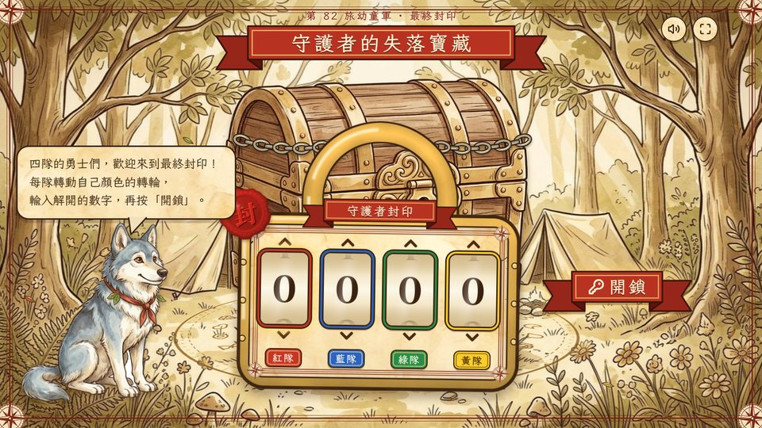

# 守護者的失落寶藏 · Cub Code Game

**第 82 旅幼童軍 · 尋寶解碼遊戲**: *The Guardian's Lost Treasure*. A printable treasure hunt and code-breaking game for Cub Scouts, with an interactive treasure-lock finale.



四隊幼童軍（紅、藍、綠、黃）逐張尋找線索卡、收集神秘符號卡，再用解碼卡把符號譯成英文字母，拼出各隊的數字。最後四隊合力在「寶藏封印」App 輸入四位密碼，打開寶箱！

## 🔓 寶藏封印 App：`index.html`

- **離線使用：** 下載 `index.html`，用 Chrome、Edge 或 Safari 開啟（單一檔案，毋須上網）。
- **網上版：** 開啟 GitHub Pages 後，可直接到 https://hinli2021.github.io/cubcodegame/
- **玩法：** 每隊轉動自己顏色的轉輪，再按「開鎖」。點擊守護精靈（小狼）可聽取提示。
- **重玩：** 長按右下角「按住重新上鎖」約 1 秒。
- **更改密碼：** 網址後加 `?code=1234`，或用文字編輯器把 `index.html` 內 `PASSCODE` 一行的數字改掉。

## 🖨️ 列印檔：`print/`

| 檔案 | 內容 | 頁數 | 紙張 |
|---|---|---|---|
| [`00_Leader_Guide.pdf`](print/00_Leader_Guide.pdf) | 領袖指南：列印清單、佈置、遊戲流程、App 用法、答案速查。⚠️ **內含答案，請勿讓隊員看到** | 4 | — |
| [`1_Scroll_and_Team_Clue_Cards_A4.pdf`](print/1_Scroll_and_Team_Clue_Cards_A4.pdf) | 故事卷軸（第 1 頁）＋ 4 隊線索卡（第 2–5 頁，每頁 1 隊 4 張） | 5 | 卷軸：普通紙或米色紙；線索卡：200–250gsm 卡紙 |
| [`2_Square_Sign_Cards_A4.pdf`](print/2_Square_Sign_Cards_A4.pdf) | 神秘符號卡（每頁 1 隊 4 張；符號四印有拼圖剪線） | 4 | 200–250gsm 卡紙，建議過膠 |
| [`3_Decoder_Cards_A4.pdf`](print/3_Decoder_Cards_A4.pdf) | 密碼翻譯提示（4 隊各 1 張，同一頁） | 1 | 200–250gsm 卡紙 |

## 🖼️ 單張圖片：`images/`

故事卷軸、各隊的線索卡／符號卡／解碼卡（`Red_Team/`、`Blue_Team/`、`Green_Team/`、`Yellow_Team/`），以及 A–Z 和空格共 27 個符號（`Signs_A-Z_and_Blank/`）。

## 🛠️ 原始碼：`source/`

用 Python 製作腳本和美術素材，可重新生成所有卡片、PDF 和 App：

```bash
pip install pillow numpy opencv-python-headless reportlab img2pdf cairosvg jieba pymupdf fonttools brotli
cd source
python3 build.py && python3 build_teams.py && python3 build_code.py   # 卷軸、線索卡、符號卡、解碼卡
python3 build_app.py                                                 # 寶藏封印 App → app/index.html
python3 build_package.py                                             # 領袖指南 + 物資包 ZIP
```

## 鳴謝 Credits

- 字型 Fonts：霞鶩文楷 TC（LXGW WenKai TC）、Noto Serif TC、Cinzel，SIL Open Font License 1.1
- 圖示 Icons：Lucide，ISC License
- 插圖 Illustrations：AI 生成 (AI-generated)
